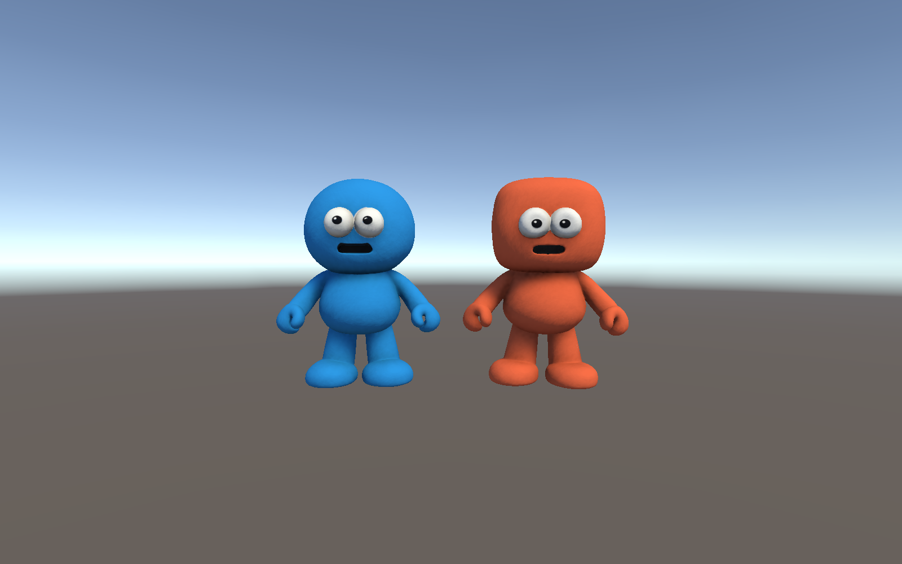
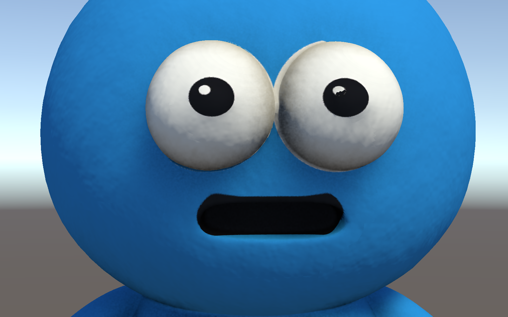
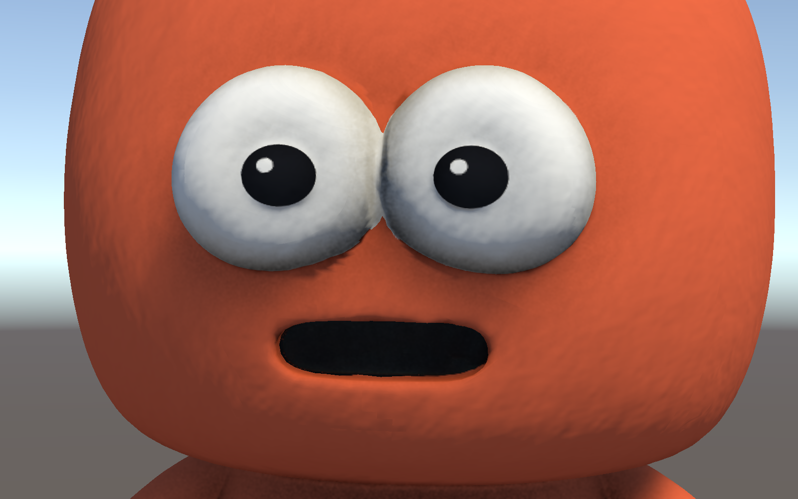

MultiMystery에 나오는 2인 협동 캐릭터 **파랑이**와 **주황이**예요.

## 캐릭터

| 파랑이 | 주황이 |
| --- | --- |
|  |  |
| 동그란 머리 | 네모난 머리 |
| `Char_Blue/` | `Char_Orange/` |

- 느낌: 손으로 빚은 **점토 인형**처럼 반짝이지 않게 만들었어요.
- 입: 지금 벌린 입은 **말하는 모습**이에요. 나중에 게임에서 입이 움직이게 할 거예요.

## 만든 방법

1. 팀원이 그린 그림을 보고 **VARCO 3D**로 3D 캐릭터를 만들었어요.
2. 눈을 동그랗게 다듬고 색을 정리했어요. 몸의 반짝임은 지웠어요.
3. 유니티에 넣고 점토 느낌의 재질을 입혔어요.

## 유니티에서 보기

- 장면: `Assets/Scenes/LHJ.unity`를 열면 두 캐릭터가 나란히 서 있어요.

## 폴더 안의 파일

| 파일 | 설명 |
| --- | --- |
| `Char_*.obj` | 캐릭터 3D 모양 |
| `Char_*_Albedo.png` | 캐릭터 색 그림 |
| `Char_*_Mat.mat` | 유니티 재질 (점토 느낌) |
| `Char_Orange/Char_Orange.blend` | 블렌더에서 색을 칠할 때 쓰는 파일 (블렌더가 설치되어 있어야 열려요) |
| `Clay_DetailNormal.png` | 점토 표면의 오돌토돌한 느낌 |
| `Docs~/` | 이 설명에 쓴 사진 (유니티에서는 안 보이는 폴더) |
